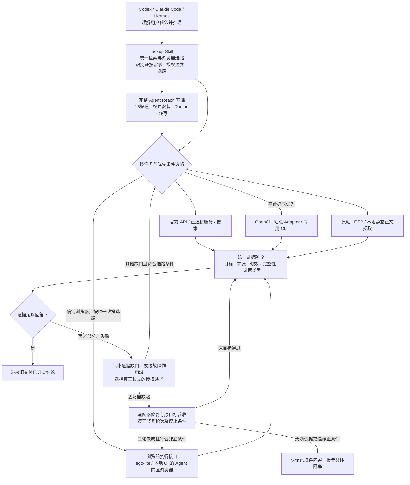

# lookup

> Complete Agent Reach and OpenCLI capabilities in one entry point for web, browser and execution-tool tasks. Skill instructions are in Chinese.

lookup 融合 Agent Reach 的完整渠道与环境能力、OpenCLI 全部执行能力，以及联网搜索、媒体和本地 UI 验收。能用 API、连接器、CLI 或系统命令完成时先用它们；确需浏览器时，只有开发中调试本地 Web UI 可用 Agent 真正内置的浏览器，其他一律用 ego-lite。ego-lite 不可用时报告阻塞，不切 Chrome 或其他浏览器。只将 lookup 注册为自动入口，由当前 Agent 按需读取平台／工具指南并执行；工具随附的通用优先声明不重做选路。完整能力、依赖和适配见 [Agent Reach 融合](references/Agent-Reach融合.md) 与 [OpenCLI 融合](references/OpenCLI融合.md)，选路分别见 [任务选路](references/任务选路.md) 与 [浏览器选路](references/浏览器选路.md)。

lookup 2.4.2完整纳入 Agent Reach 主分支 `94f06c1` 的121个来源文件、16个渠道、11类 CLI、7类参考、5份设置指南、MCP 和公开 Python 接口；同时纳入 OpenCLI 正式版2.0.2的170个站点、1,223条站点命令和66条内置命令，以及全部5套 Skill。Agent Reach 来源随压缩快照保存；OpenCLI 完整源码／发布包以逐文件回执固定，完整源码可校验后按需缓存，原始 Skill 不进入自动发现。平台可用性仍取决于本机工具、账号和当前真实结果；完整融合不表示所有站点已逐项实测。

平台抓取优先发现并实测 OpenCLI 动作，保留 yt-dlp 等更合适的专用 CLI；网站改版导致适配失效时先修复，经过3轮有效修复仍未完成目标才允许 ego-lite 通用浏览器抓取兜底。轮次、记录与停止条件统一见 [适配器修复与浏览器兜底](references/failure-domains.md#适配器修复与浏览器兜底)，普通重跑不算修复，成功即停。连接探针不能代替业务调用；用户指定、视觉／交互目标和账号／权限边界分别判断。全网搜索顺序只用于全网搜索。小红书新版布局的定向修复见[执行与诊断](references/opencli-windows.md#小红书新版搜索适配)。

小红书、Douyin、B站等平台按具体动作判断是否需要登录。需要登录且当前未登录时，lookup 会提前说明，打开 CLI 原绑定的浏览器和 Profile 供用户手动操作；收到恢复信号并核对后，继续原 CLI 动作。登录准备不占三轮适配修复次数，也不批准转为浏览器全程抓取；验证码、风控和用户接管期间暂停相关自动操作。具体流程见 [登录准备与恢复](references/opencli-windows.md#登录准备与恢复)。

## 可以怎样使用

直接描述要找什么、时间范围和期望结果即可，不必先指定工具。lookup 负责选择路径和核验证据，实际读取由下面列出的工具完成；工具与账号需要在当前环境可用。

历史能力验证以 lookup 1.16.0、OpenCLI 2.0.2、ego-browser 2.1.0及 macOS 为基线；本次补验为 lookup 2.1.1工作区与 OpenCLI 2.0.2，适配器修复条件随平台注明。**真实验证**指在真实站点完成表中注明的动作；**受控验证**指使用自建页面或合成材料；**离线验证**指本地回归测试。验证只覆盖注明的路径与样本，不能推广为所有站点、账号或客户端均可用；已验证的能力仍可能依赖登录、扩展和媒体工具。后续补验进度见仓库 [ROADMAP.md](../ROADMAP.md)。

| 类别 | 可以直接提出的请求 | 调用的能力 | 已验证范围与使用条件 |
|---|---|---|---|
| 全网搜索与近期资讯 | 找近一周的 AI 工具更新，附原始出处和发布时间。 | 宿主搜索、已连接搜索服务；国内内容优先豆包 → Tavily → Exa；其他普通搜索 Exa → Tavily → 豆包 | Tavily／Exa 的账号与免 Key 搜索均有真实验证；优先满足授权、归属和免费边界的账号，条件未确认时可用明确免 Key 入口。豆包 Global 沿用既有真实验证，本轮按用户要求只验费用阻断与合成场景。独立用户流程与限流回放的覆盖见 ROADMAP；时间缺失时不能认定为近期。 |
| 官方资料与技术核实 | 查这个库当前版本的超时默认值，说明和旧版本有什么不同。 | 官方文档、GitHub、搜索 | 已真实核对官方参数及版本差异；教程和摘要只用于定位，结论需对应版本原文。 |
| 普通网页阅读 | 总结这篇博客的核心观点，不用保存全文。 | 原站 HTTP、本地正文提取；动态页使用浏览器 | 真实博客正文读取通过；登录页、动态壳和截断内容须补证，不能直接当正文。 |
| 多来源研究 | 比较这两篇文章的结论，解释样本和统计口径为何不同。 | 原文检索、来源比对和研究综合规则 | 不同样本与条件的合成材料已受控验证；转载数量不代表独立来源数量。 |
| 论坛与评论 | 从 V2EX 找两篇工具讨论，结合正文和评论总结优缺点。 | OpenCLI 站点动作或浏览器 | 已真实读取两篇正文及部分评论；未证明任意评论区或全部分页均已覆盖。 |
| 动态页面与表格 | 等报表筛选刷新后，提取全部200行，保留空值。 | 浏览器、适用 API、分页与 iframe／Shadow DOM 读取 | 200行分页等在受控页面通过；动态等待和跨域 frame 另有真实示例验证。真实业务后台仍需逐项核对范围和结束条件。 |
| 图片与视频画面 | 解释这张图；比较视频第1秒和第7秒的界面变化。 | 原图读取、浏览器截图、定点采帧 | 已验证图片加载状态和指定时刻画面；采样不代表看完视频，字幕也不证明画面内容。 |
| 保存与下载 | 保存这篇文章及配图；把指定视频下载到我给的目录。 | 优先适用 OpenCLI／专用 CLI、文件核验；指定视频落盘交给 download-video | 小红书正文6图、公众号正文5图有真实归档证据；X 单帖图片按修复后的动作补验。完整视频下载未纳入本轮，普通阅读不会默认下载。 |
| 历史与书签找回 | 找到我昨天在 Ego Lite 看过的内部报表地址。 | 单 Profile 历史／书签 helper；必要时原生历史页 | 历史锁定分类、释放后读取有离线回归，原生历史补救已真实通过；不遍历其他 Profile，不把内部关键词发到公网。 |
| 网页交互 | 筛选最近一周的结果，再打开详情核对作者和时间。 | ego-browser 或按任务选定的浏览器接口 | 真实筛选与详情核对通过；账号权限决定可见范围。发布、评论等按用户授权执行，本次未验证真实外部写入。 |
| 本地 UI 验收 | 检查这个页面的筛选、分页和手机布局。 | 本地开发时用 Agent 内置浏览器，否则用 ego-lite | 控件、分页与媒体有受控验证；已有用户标注和手机布局修复分支未完整实测。 |
| 读取故障诊断 | 页面能打开，为什么工具读不到正文？ | 原生 doctor、错误分类、访问上下文与独立路径判断 | 连接诊断、业务错误、超时和锁定有真实或离线证据；诊断正常只证明对应探针可用。 |

## 常用平台的实际覆盖

“OpenCLI 支持某站点”表示存在该站点的具体命令。能搜索不代表能读全帖、完整评论、所有图片或转写音频；实际动作以当前帮助为准，选路见 [平台参考](references/platform-routing.md)。

| 平台与请求示例 | 可调用的路径 | 已真实验证 | 依赖环境或尚未完整验证 |
|---|---|---|---|
| 公众号：找一篇讲 AI 记忆机制的文章并总结。 | 已连接来源、OpenCLI 搜索；保存时优先 download，必要时 OpenCLI Browser 解析跳转 | 正文读取、搜索后定位；另有同一文章正文和5张配图的 CLI 归档 | 搜索覆盖和签名链接有时效边界。链接过期后须重新核对同一对象；外层成功不能代替下载行状态、正文与文件验收。 |
| X：看看最近两天某工具的讨论，附作者、时间和原帖。 | OpenCLI 搜索、thread／download等适用动作，按缺口补证 | 两类搜索、原 thread 动作与单帖原图下载 | thread包含回复，须按作者和回复关系区分；单帖下载的2.0.2补丁与覆盖见执行参考。完整作者时间线和评论全量仍未逐一验收。 |
| 小红书：读这篇笔记，并下载它的全部图片。 | 优先 OpenCLI search／note／download，按实际动作缺口换路 | 新版搜索布局修复后返回5条候选，同一笔记正文与6张图片经 CLI 复验 | 新布局需定向 override；历史 `SECURITY_BLOCK` 不代表当前所有动作失效，当前挑战仍停止相关操作。依赖指定 Profile 登录态与完整访问链接。 |
| B站：找最新教程，说明视频实际讲了什么。 | OpenCLI、可选 bili-cli、Ego Lite | OpenCLI 取得685段字幕，浏览器核对及最新发布排序通过 | 字幕需能获取且语义可靠；未逐一验证全部 CLI 动作，也未完整观看全部画面。 |
| YouTube：总结这个视频，列出关键观点的时间点。 | yt-dlp、OpenCLI transcript；无可靠字幕时按需转写 | 同一视频的117段字幕读取通过，另有跨语言字幕核对 | 依赖字幕轨道、网络和工具运行时；自动字幕与人工字幕均需质量核对。无字幕视频需要可用 ASR，字幕结论不覆盖全片视觉。 |
| Douyin：筛选最近一天的内容；完整转写这条视频的口播。 | OpenCLI search／detail／user-videos；Ego Lite 页面筛选与媒体读取；独立 ASR | detail、最新发布加一周内／一天内筛选通过；62.9秒完整音轨送入本地 ASR，得到30段并定向校对 | 当前已验 CLI 没有日期筛选参数或完整 ASR 动作。临时转写环境已清理，常备 ASR 尚未配置；短音轨通过不代表长视频或逐字人工听审。近期结果可能含图文，不能冒充视频内容。 |

Ego Lite 是基于 Chromium 的浏览器，OpenCLI 是独立项目。两条路径分别为 **OpenCLI CLI → OpenCLI Chrome 扩展 → Ego Lite** 和 **ego-browser 执行接口 → Ego Lite**。后者选中后通过 `ego-browser skill` 读取完整指南。OpenCLI 选择实际 `contextId` 或已核实的本机别名，运行入口固定首次确认的 ego-lite 连接，不给产品名设置默认 Profile。需登录的动作在该 ego-lite 环境交接；出现账号挑战时交还控制。

## 能力边界

- **视频内容必须有内容证据。** 标题和简介只能说明发布者如何介绍视频。口播摘要依据可靠字幕或实际音轨转写；操作、图表和演示结论需对应画面。时长、覆盖范围和未读取部分按 [字幕与转写](references/youtube-subtitles.md)、[媒体读取](references/媒体读取.md) 核验。
- **ASR 不是随包常备服务。** 本地或已配置服务商的转写能力可接入，但需要可访问的音轨、ffmpeg／ffprobe、模型或服务环境。普通查询不会自动安装大模型、启用付费服务或导出 Cookie。
- **覆盖仍有边界。** 长视频、多说话人、方言、噪声、多语言、直播及连续画面尚未系统验收；多视频与评论的近期综合研究也不能由一次筛选成功代替。
- **运行环境需要匹配。** 其他机器、宿主 Agent、操作系统和 Profile 未全部验收；Agent Reach 原始资料随包分发，Python 引擎和具体平台工具按需准备，资料存在不证明真实账号可用。轻舟仍需独立环境；web-access 仅提供方法参考，未引入其 Proxy。
- **补救成功不等于故障消失。** 原生历史页可找回目标，不代表 SQLite 锁已解除；另一条授权路径读取成功，也不代表原适配器已修好。
- **持续监控、大批量采集和自动发布需要单独工作流。** lookup 提供查询与执行选路、证据核验和换路边界；定时调度、长期存储、账号运营及真实写入授权由对应系统和任务负责。

## 架构概览

下图是任务级选路关系，并不表示四种执行路径会被同时调用。Agent Reach 的完整能力已成为 lookup 的基础，主 Agent 只从 lookup 进入；按需加载平台知识和工具接口，不将上游注册为第二个总路由。



路由由当前 Agent 按 [任务选路](references/任务选路.md)、[浏览器选路](references/浏览器选路.md) 和 [失败作用域与结果验收](references/failure-domains.md) 执行，图示和 providers 台账不是自动调度器。上游工具可用、Bridge 已连接、Doctor 报告正常，都不等于当前任务已完成；对字幕、评论、表格分页、视频画面等证据分别验收。OpenCLI Adapter 与通用 Browser Use 可能共用 Bridge，不是彼此独立的故障备份。普通读取不自动安装工具、迁移登录态或扩大数据外发权限。


## 职责与可移植性

职责、加载与新候选准入统一见 [任务选路.md](references/任务选路.md#职责与加载边界)。lookup 保留一个通用入口，底层工具负责执行；有竞争性的通用路由 Skill 不同时加入自动发现，上游包与原始描述保持完整。

OpenCLI 独立于 Agent，当前验证基线为正式版2.0.2；入口版本范围、本机升级与执行接口见 [执行与升级边界](references/opencli-windows.md)。lookup 不再修改 Commander 或自行管理 daemon；薄入口只保留明确 Profile、总等待预算、认证范围与原生清理选项。版本升级须核对实际命令与受影响场景。

## 本体与上游更新

lookup 2.1.0统一自然语言、终端和 Skill Manager 的更新入口。“更新／升级 lookup”默认维护本体和已安装上游。使用相关依赖时仍启动有界检查，缓存24小时，同一新版只提醒一次；默认只提醒，检查失败不阻断业务。明确开启 OpenCLI 托管后，Agent 在任务结束时维护并前后告知。命令范围、本体来源、定制接续与恢复统一见 [上游更新.md](references/上游更新.md)。

安装终端入口，不覆盖已有同名命令：

```bash
python3 ~/.agents/skills/lookup/scripts/install-cli.py
lookup update
lookup update --self-only
lookup upgrade
lookup upgrade opencli
lookup upgrade agent-reach
lookup upgrade ego-browser
```

从当前 Skill 目录也可运行 `python3 scripts/install-cli.py`。入口是 `~/.local/bin/lookup` 到唯一源码的单跳链接；该目录需已在 PATH。重复安装保持同一链接；其他来源的同名文件或断链会拒绝覆盖。

`lookup update` 维护本体和已安装的 OpenCLI、Agent Reach 与 Ego；`--self-only` 只更新本体，`lookup upgrade` 只更新上游，指定名称只更新该项。旧 `lookup update <dependency>` 保留兼容。缺失依赖跳过，不自动新增安装。本体仅处理官方选定通道的完整 `lookup/`，保留其他 Skill、Git HEAD、禁用状态和本机运行文件；无法核实旧源或发现定制时先生成比较材料。源码切换后加载新维护器，再验证上游。Skill Manager 的 `update lookup`、单项和批量检查调用同一维护入口；它不是运行终端命令的必装依赖。

OpenCLI 候选验证后才切换有效版本；Agent Reach 使用原管理器或虚拟环境，保留来源并备份；Ego 调用原生 `ego-browser upgrade`，可能重启浏览器或等待界面确认。各项分别报告，部分完成或结果未知不算总更新成功。

更新会检查包内补丁、adapter、plugin 及独立 Skill。由维护 Agent 比较旧上游、本地与新上游，确认新版已支持的定制采用上游实现，尚未支持的定制继续保留。命令、自然语言和托管使用相同机制；独立终端需要语义判断时返回可接续材料，由 Agent 完成合并并核验后继续，不直接覆盖。回执用法及未知基线的处理见 [定制核对与合并](references/上游更新.md#定制核对与合并)。

Ego 原操作已完成或取消后，可用 `lookup upgrade ego-browser --retry` 显式重试；结果未知时先核对原操作。web-access 当前只提供方法参考，不列为已接入的可更新运行依赖。Ego 暂无已核实的只读新版查询接口，普通查询只检测本机版本变化，不调用包含安装的升级命令来探测。

当前检查及维护脚本的锁机制支持 macOS／Linux，依赖 Python ≥ 3.9；托管安装另需已有 Node.js 和 npm。CI 不自动发起远端更新检查；显式 `lookup update` 仍按用户请求执行。真实浏览器、所有平台和其他系统的验收范围分别报告。

动态等待、iframe 与媒体是跨工具验收条件，分别见 [动态页面读取](references/动态页面读取.md) 与 [媒体读取](references/媒体读取.md)。它们参考 web-access 的有效方法，不引入 Proxy 或另一套调度入口。

## 按需依赖

Tavily／Exa 用户级账号／免 Key 接入、豆包配置与额度切换见 [搜索服务接入与验证](references/search-routing.md#搜索服务接入与验证)。lookup 1.18.2按内容来源选路：国内内容优先豆包，其他普通搜索使用 Exa → Tavily → 豆包；补清账号免费边界未确认时的免 Key 选择和本地执行环境失败的判断。Exa 独立自检继续保留，Tavily 按文档命令单独验收；上表其他平台沿用注明的既有基线，不代表本次重新验收全部平台。

| 依赖 | 用途与边界 |
|---|---|
| 当前 Agent 搜索、连接器或官方文档能力 | 优先使用已安装且适合任务的来源 |
| OpenCLI 与已配置 Profile | 平台结构化动作；缺失时选择其他可用路径 |
| Node.js ≥ 20.18.1 | 当前 OpenCLI 的运行要求；随包 mjs helper 随之使用同一环境 |
| yt-dlp 与其要求的 JS runtime | YouTube 搜索及人工／自动字幕 |
| ffmpeg／ffprobe 与可用 ASR | 按需核对、转换媒体和转写音轨；模型或服务需另行配置 |
| bili-cli | B站搜索／详情／音频的可选直接路径 |
| mcporter 与已配置的 Tavily／Exa／豆包 | 可选搜索来源，额度和费用边界分别核对，不要求每个人都安装 |
| Agent Reach 融合引擎 | 完整原始资料随包；需要时用 `scripts/reach.py prepare` 准备私有 Python 环境，诊断、配置和转写通过同一来源执行；不注册额外 Skill |
| python3、curl、jq | 正文提取、结果处理和 OpenCLI 门禁／合约检查 |
| ego lite 与随包执行指南 | 按浏览器路由选中后用 `ego-browser skill` 读取正式接口；平台抓取仍遵守修复门槛，不注册额外自动入口 |
| 当前 Agent Browser／DevTools | 仅开发中调试本地 Web UI 使用真正内置浏览器；不接管 Chrome |

静态正文脚本 `scripts/fetch.sh` 随 Skill 分发，默认只请求原站、本地提取，不自动安装依赖或转发第三方。支持 HTTP(S) HTML、纯文本与 Markdown，保留最终来源 URL；拒绝凭据 URL、非文本响应和超出大小限制的内容。`--prefer` 选择提取器，`--max-output-chars` 默认 40,000；stdout 保持正文，stderr 给机器可读状态。exit 3 表示有正文但截断，仍可按任务使用已证实部分。已有 `readability-lxml`／`html2text` 时可提升提取质量。

相关 Waza 衍生实现保留 [原作者 MIT 许可](scripts/LICENSE-waza)。具体依赖安装与版本以工具自己的官方文档为准，普通查询不自动维护环境。

## 安装

多客户端共用时安装到共享目录：

```bash
git clone https://github.com/ldl8818/skills.git
mkdir -p ~/.agents/skills
test ! -e ~/.agents/skills/lookup && test ! -L ~/.agents/skills/lookup && \
  rsync -a --exclude '.DS_Store' skills/lookup/ ~/.agents/skills/lookup/
```

上面的复制步骤只接受未安装的目标。共享入口已存在或是软链时，先确认其真实来源，再更新原安装或其 Git checkout，不覆盖另一份安装。再给需要的客户端建立单 Skill 软链；客户端目标已存在时同样先核对来源：

```bash
mkdir -p ~/.claude/skills ~/.codex/skills
test ! -e ~/.claude/skills/lookup && test ! -L ~/.claude/skills/lookup && \
  ln -s ~/.agents/skills/lookup ~/.claude/skills/lookup
test ! -e ~/.codex/skills/lookup && test ! -L ~/.codex/skills/lookup && \
  ln -s ~/.agents/skills/lookup ~/.codex/skills/lookup
```

只给一个客户端使用时，可直接安装到该客户端发现的 Skill 目录。安装后按 [客户端发现与恢复](references/Agent-Reach融合.md#客户端发现与恢复) 检查并迁出竞争入口；脚本保留原始来源与恢复记录，不修改上游触发原文。新开或重启客户端会话后，用「搜一下」「读这个链接」「这个视频讲了什么」「帮我配某个平台」触发。Skill 只能路由实际加载它的 Agent，不替未加载的客户端强制拦截联网操作。共享全局规则将浏览器与联网检索选路指向 lookup，场景默认项只在 [浏览器选路.md](references/浏览器选路.md) 维护；用户指定环境、授权与安全边界保留。

### OpenCLI Profile

先按 OpenCLI 官方文档安装扩展，在 ego-lite 中确认真实连接并用 `opencli profile list` 核对 `contextId`，再按 [Profile 绑定](references/opencli-windows.md#profile-绑定) 保存本机确认结果。多连接时不猜测，不重命名为产品名，不改变 OpenCLI 默认值。

runner、health 与 selftest 共用该绑定；缺失、空值、别名丢失或改指、Profile 冲突时返回78。`LOOKUP_OPENCLI_PROFILE` 可指定已绑定实际 ID 或已核实指向它的本机别名，最终传入实际 ID。绑定只供 OpenCLI 使用，不复制为 ego-browser 的 `profileId`；helper 不替用户登录，不导出 Cookie。

ego 不是必装前提；需要它时用 `ego-browser skill` 按需读取当前正式执行指南。任务脚本使用 `scripts/ego-run.mjs` 的本任务 lease 与 finally 收尾，多轮交互通过 `scripts/ego-task.mjs` 复用该 lease；只关闭有本任务创建证据的空间。旧空间辅助脚本仍只做保守检查，普通安装不自动写 hook、不按全局闲置时间回收未知空间，见 [ego-space-hooks.md](references/ego-space-hooks.md)。

## 验证

从 lookup 根目录运行：

```bash
bash scripts/selftest.sh
bash scripts/selftest.sh --auth
bash scripts/selftest.sh --live
bash scripts/selftest.sh --search
python3 scripts/reach.py verify
python3 scripts/entrypoints.py audit --lookup-root /absolute/lookup
python3 -m unittest discover -s tests -p 'test_reach.py'
python3 -m unittest discover -s tests -p 'test_entrypoints.py'
bash tests/test_opencli_health.sh
bash tests/test_find_url.sh
bash tests/test_match_site.sh
python3 -m unittest discover -s tests -p 'test_fetch.py'
python3 -m unittest discover -s tests -p 'test_result_helpers.py'
```

全量离线回归使用 `python3 -m unittest discover -s tests` 与 `node --test tests/*.mjs`。它们使用合成数据和隔离环境，不证明真实站点、登录交接或客户端自动触发已通过。

默认自检查本地依赖、明确 Profile 的原生 doctor 和必要命令帮助；`--auth` 增加有界认证检查，`--live` 再执行一条最小业务查询并使用原生 owned tab 清理。可选候选缺失、合约漂移和真实业务失败分别报告。

`--search` 是独立模式：只验证 Exa 免 Key 配置、工具 schema 和一次真实搜索，不运行浏览器检查，不调用豆包。返回非零表示配置、接口或内容验收失败；输出中的豆包状态只表示配置是否可读，不证明登录、免费额度或搜索可用。安装了 mcporter 不等于这些后端均通过。

OpenCLI 输出格式、超时与升级要求只在 [执行与升级边界](references/opencli-windows.md) 维护。结果 helper 处理已捕获的数据，不联网、不调度；字幕 helper 保留时间位置与合法重复。

## 行为评估

`evals/evals.json` 保留原有场景并补充故障作用域、已有足够正文、人工字幕、浏览器选择、未知指标与空间归属，以及动态等待、frame／组件、访问上下文和媒体证据等边界。用例是评估规范，不是已完成的跑分。

从实际 transcript 和交付内容检查是否满足目标、授权、时效、来源与证据标准；工具名只在能力或契约本身是测试目标时限定。不要求无意义的固定二次请求，不以运行了某个命令替代内容验收。离线单元测试、场景评估和真实平台验证分别报告。

## 本机数据

可复用公开站点经验位于 `~/.agents/data/site-patterns/`，不在 Skill 安装目录里。匹配命令：

```bash
node scripts/match-site.mjs "<用户输入或目标域名>"
node scripts/find-url.mjs "<关键词>" --since 7d
```

`find-url.mjs` 只查 ego lite 的一个 Profile：默认 `Local State` 的 `profile.last_used`，未设置则 `Default`；`--profile "<已登记目录名>"` 可指定授权目标，不遍历所有 Profile。`--json` 提供结构化结果与 `more_available`，错误不会伪装成空列表；普通 top-N 和触及保护上限的 partial 分别报告。其他浏览器的历史不因已登录或本脚本无结果而自动纳入；须由用户当次明确改变范围，不猜内部地址、不把内部关键词发到公网。详细输出与退出码见 [search-routing.md](references/search-routing.md)。

## 参考文件

| 文件 | 读取时机 |
|---|---|
| [任务选路.md](references/任务选路.md) | 多后端筛选、复用上游资料及区分环境可用与任务完成 |
| [OpenCLI融合.md](references/OpenCLI融合.md) | 全部站点与内置命令、5套指南、CDP、插件及适配器开发维护 |
| [浏览器选路.md](references/浏览器选路.md) | CLI 优先、本地 Web UI 内置浏览器例外与 ego-lite 唯一边界 |
| [动态页面读取.md](references/动态页面读取.md) | 内容就绪与有界等待、登录提示、访问上下文、iframe／Shadow DOM |
| [媒体读取.md](references/媒体读取.md) | 图片懒加载与实际资源、视频定位／采帧、证据覆盖范围 |
| [search-routing.md](references/search-routing.md) | 全网搜索、网页、历史与站点经验 |
| [platform-routing.md](references/platform-routing.md) | 平台动作、命令发现与维护边界 |
| [failure-domains.md](references/failure-domains.md) | 失败作用域、结果信封与有界降级 |
| [providers.json](references/providers.json) | 跨工具策略、必要合约与证据条件；不自动执行 |
| [youtube-subtitles.md](references/youtube-subtitles.md) | 字幕、视频证据与转写 |
| [weixin-article.md](references/weixin-article.md) | 公众号跳转与正文 |
| [ego-space-hooks.md](references/ego-space-hooks.md) | 正式 ego-browser 入口与空间归属 |
| [opencli-windows.md](references/opencli-windows.md) | OpenCLI 执行、原生诊断／清理、升级契约 |
| [上游更新.md](references/上游更新.md) | 使用时提醒、`lookup update`、托管授权与失败恢复 |
| [研究综合.md](references/研究综合.md) | 多来源分析；普通搜索不加载 |

## License

MIT，见仓库根 [LICENSE](../LICENSE)。
