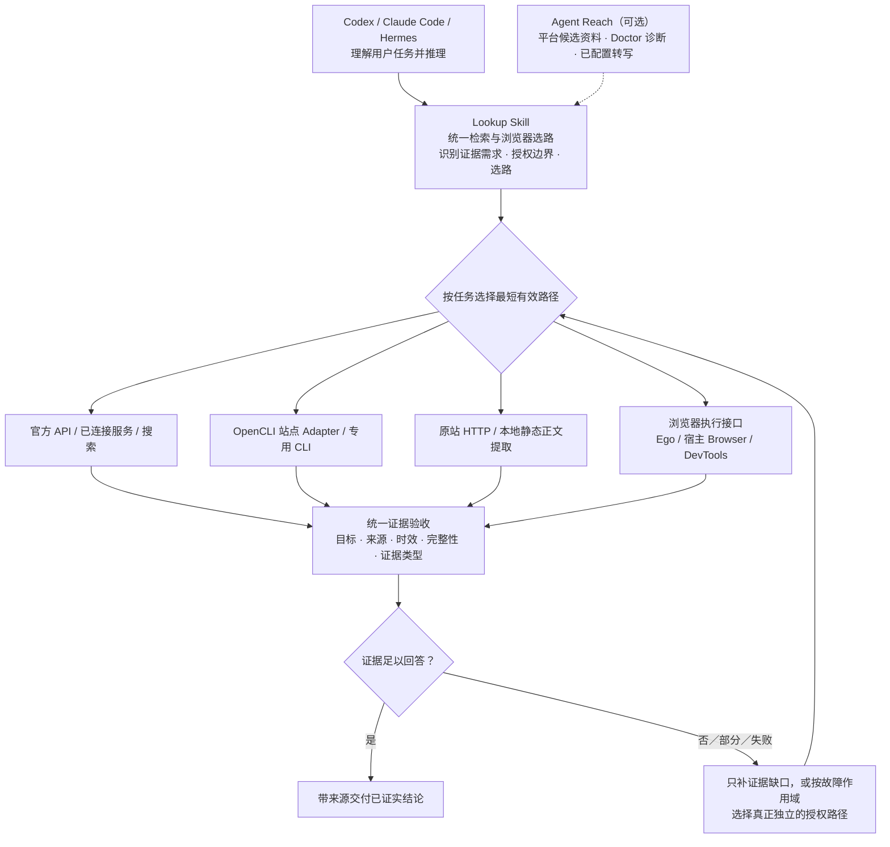

# lookup

> One routing entry point for web search, content retrieval and browser tasks. Skill instructions are in Chinese.

Lookup 是联网搜索、网页访问与浏览器任务的统一选路入口，包含本地 UI 验收；选定后交给专用 Skill、连接器、CLI 或宿主浏览器执行。工具随附的通用优先声明不重做选路。专用来源和浏览器候选统一见 [任务选路](references/任务选路.md) 与 [浏览器选路](references/浏览器选路.md)。

## 架构概览

下图是任务级选路关系，并不表示四种执行路径会被同时调用。Lookup 是唯一通用检索与浏览器选路入口；Agent Reach 本身也具备路由能力，但在此组合中只按需提供候选资料、环境诊断和已配置的转写能力，不作为第二个自动触发的总路由。



路由遵循 [任务选路](references/任务选路.md)、[浏览器选路](references/浏览器选路.md) 和 [失败作用域与结果验收](references/failure-domains.md)。上游工具可用、Bridge 已连接、Doctor 报告正常，都不等于当前任务已完成；对字幕、评论、表格分页、视频画面等证据分别验收。OpenCLI Adapter 与通用 Browser Use 可能共用 Bridge，不是彼此独立的故障备份。普通读取不自动安装工具、迁移登录态或扩大数据外发权限。


## 职责与可移植性

Lookup 是策略层，不复制平台爬取实现。它保留几类跨工具判断：

- 先取结构化字段或定向正文，完整短帖已足够时不多请求一次。
- 区分成功、真实无匹配、部分证据与失败，保留来源、时间、访问 URL 和证据类型。
- 按 bridge/Profile、站点账号、site/action 分别降级；一个动作出错不拖垮全部平台。
- 核对工具是否共享浏览器、账号或网络，选择能绕过失败依赖的候选。
- 根据安装版本发现公开命令；不把历史经验、无窗口或零费用写成永久保证。

**OpenCLI 是独立开源工具。** 浏览器能力和登录态是否可用取决于用户环境，不绑定某一个 Agent。Lookup 的 OpenCLI helper 默认使用已有 `ego-lite` Profile，也支持用 `LOOKUP_OPENCLI_PROFILE` 指定其他明确配置的 Profile；它不会自行换账号。历史检索脚本仍只支持 ego lite，这是局部能力限制，不代表其他联网路径不可用。

Agent Reach 与 Lookup 都包含检索路由。此组合保留 Lookup 一个通用入口，按需复用 Agent Reach 的平台候选资料、诊断及已配置转写，不复制其完整后端目录，也不要求每条请求经过它。命令参数以当前注册表／帮助为准；本地台账只保留必要合约和证据边界，见 [任务选路.md](references/任务选路.md)。

动态文章和表格复用当前浏览器的提取能力，分别核对正文、分页和可见行范围。轻舟可作为专项候选；只有证明当前 MCP 接口、会话生命周期与收尾适合任务后才接入，不作为默认依赖，也不假定共享模型登录。

页面读取按目标内容而非导航回执验收；等待预算、登录提示、完整访问上下文、iframe 与 Shadow DOM 见 [动态页面读取](references/动态页面读取.md)。需要图片细节或视频画面时再读 [媒体读取](references/媒体读取.md)，核对懒加载、实际资源、采样时间与新帧。两份参考吸收 web-access 2.6.0 的有效策略并补充技术边界；不引入其 Proxy、CDP 前置检查或第二个自动路由。

## 按需依赖

| 依赖 | 用途与边界 |
|---|---|
| 当前 Agent 搜索、连接器或官方文档能力 | 优先使用已安装且适合任务的来源 |
| OpenCLI 与已配置 Profile | 平台结构化动作；缺失时选择其他可用路径 |
| Node.js ≥ 20.18.1 | 当前 OpenCLI 的运行要求；随包 mjs helper 随之使用同一环境 |
| yt-dlp 与其要求的 JS runtime | YouTube 搜索及人工／自动字幕 |
| bili-cli | B站搜索／详情／音频的可选直接路径 |
| mcporter 与已配置的 Exa／豆包等 | 可选搜索来源，不要求每个人都安装 |
| agent-reach | 可选环境诊断与转写；转写另需 ffmpeg／ffprobe 和配置好的服务商 |
| python3、curl、jq | 正文提取、结果处理和 OpenCLI 门禁／合约检查 |
| ego lite 与正式 ego-browser Skill | 本机日常外部网页的默认浏览器；按当前正式接口操作 |
| 当前 Agent Browser／DevTools | 按开发、标注、调试、指定环境及技术降级需求选择 |

静态正文脚本 `scripts/fetch.sh` 随 Skill 分发，默认只请求原站、本地提取，不自动安装依赖或转发第三方。支持 HTTP(S) HTML、纯文本与 Markdown，保留最终来源 URL；拒绝凭据 URL、非文本响应和超出大小限制的内容。`--prefer` 选择提取器，`--max-output-chars` 默认 40,000；stdout 保持正文，stderr 给机器可读状态。exit 3 表示有正文但截断，仍可按任务使用已证实部分。已有 `readability-lxml`／`html2text` 时可提升提取质量。

相关 Waza 衍生实现保留 [原作者 MIT 许可](scripts/LICENSE-waza)。具体依赖安装与版本以工具自己的官方文档为准，普通查询不自动维护环境。

## 安装

多客户端共用时安装到共享目录：

```bash
git clone https://github.com/ldl8818/skills.git
mkdir -p ~/.agents/skills
test ! -e ~/.agents/skills/lookup && test ! -L ~/.agents/skills/lookup && \
  rsync -a --exclude '.DS_Store' skills/lookup/ ~/.agents/skills/lookup/
```

上面的复制步骤只接受未安装的目标。共享入口已存在或是软链时，先确认其真实来源，再更新原安装或其 Git checkout，不覆盖另一份安装。再给需要的客户端建立单 Skill 软链；客户端目标已存在时同样先核对来源：

```bash
mkdir -p ~/.claude/skills ~/.codex/skills
test ! -e ~/.claude/skills/lookup && test ! -L ~/.claude/skills/lookup && \
  ln -s ~/.agents/skills/lookup ~/.claude/skills/lookup
test ! -e ~/.codex/skills/lookup && test ! -L ~/.codex/skills/lookup && \
  ln -s ~/.agents/skills/lookup ~/.codex/skills/lookup
```

只给一个客户端使用时，可直接安装到该客户端发现的 Skill 目录。新开或重启客户端会话后，用「搜一下」「读这个链接」「这个视频讲了什么」触发。Skill 只能路由实际加载它的 Agent，不替未加载的客户端强制拦截联网操作。共享全局规则将浏览器与联网检索选路指向 Lookup，场景默认项只在 [浏览器选路.md](references/浏览器选路.md) 维护；用户指定环境、授权与安全边界保留。默认选择不等于强制所有 Agent、账号和任务使用同一个浏览器。

### OpenCLI Profile

先按 OpenCLI 官方文档完成安装及扩展连接，再从实际 Profile 清单选择用户明确使用的浏览器。不要用其他 Profile 通过门禁：

```bash
opencli profile list
opencli profile rename <contextId> ego-lite
```

默认别名是 `ego-lite`。需要另一明确配置的 Profile 时，给 health 与 runner 使用同一 `LOOKUP_OPENCLI_PROFILE` 环境变量。helper 不替用户登录，也不注入或导出 Cookie。

ego 不是必装前提；需要它时加载当前正式 `ego-browser` Skill。任务脚本使用 `scripts/ego-run.mjs` 的本任务 lease 与 finally 收尾，多轮交互通过 `scripts/ego-task.mjs` 复用该 lease；只关闭有本任务创建证据的空间。旧空间辅助脚本仍只做保守检查，普通安装不自动写 hook、不按全局闲置时间回收未知空间，见 [ego-space-hooks.md](references/ego-space-hooks.md)。

## 验证

从 Lookup 根目录运行：

```bash
bash scripts/selftest.sh
bash scripts/selftest.sh --auth
bash scripts/selftest.sh --live
bash tests/test_opencli_health.sh
bash tests/test_find_url.sh
bash tests/test_match_site.sh
python3 -m unittest discover -s tests -p 'test_fetch.py'
python3 -m unittest discover -s tests -p 'test_result_helpers.py'
```

默认自检查本地依赖、选定 bridge/Profile 和必要注册表合约，不发平台业务请求。daemon 休眠时可按需启动。`--auth` 增加有界认证检查；`--live` 再发一条最小业务查询，可能创建或复用浏览器资源。可选候选缺失、合约漂移和实际业务失败分别报告。

健康检查对已运行 daemon 快速返回。冷启动分两段：先用3.2秒等待 daemon 监听，再给扩展17秒完成已有重连退避；收到断连状态不会反复延长预算。未监听的失败在正常调度下5秒内返回，冷启动重连连同收尾在22秒内结束。只检查状态，不重发平台动作，也不切换到其他已连接 Profile。

`node scripts/opencli-run.mjs ...` 负责 Profile 一致性与有界异步等待。`OPENCLI_RUN_IMPORT_TIMEOUT_MS` 默认给入口加载 15 秒；`LOOKUP_OPENCLI_TIMEOUT_MS` 默认给整个调用 90 秒，包含加载阶段。业务超时后不能自动重派同一动作。兼容补丁的版本与源码条件见 [opencli-windows.md](references/opencli-windows.md)，工具升级后需重新核验该入口。

结果 helper 只处理已捕获的数据：`scripts/normalize-result.py` 从 stdin 读取包含 provider、exit_code、stdout、stderr 的 JSON 信封；`scripts/clean-subtitles.py` 清洗实际字幕文件，保留时间位置与合法重复。它们不自动选择工具、登录或查询，具体输入见对应参考与 `--help`。

## 行为评估

`evals/evals.json` 保留原有场景并补充故障作用域、已有足够正文、人工字幕、浏览器选择、未知指标与空间归属，以及动态等待、frame／组件、访问上下文和媒体证据等边界。用例是评估规范，不是已完成的跑分。

从实际 transcript 和交付内容检查是否满足目标、授权、时效、来源与证据标准；工具名只在能力或契约本身是测试目标时限定。不要求无意义的固定二次请求，不以运行了某个命令替代内容验收。离线单元测试、场景评估和真实平台验证分别报告。

## 本机数据

可复用公开站点经验位于 `~/.agents/data/site-patterns/`，不在 Skill 安装目录里。匹配命令：

```bash
node scripts/match-site.mjs "<用户输入或目标域名>"
node scripts/find-url.mjs "<关键词>" --since 7d
```

`find-url.mjs` 只查 ego lite 的一个 Profile：默认 `Local State` 的 `profile.last_used`，未设置则 `Default`；`--profile "<已登记目录名>"` 可指定授权目标，不遍历所有 Profile。`--json` 提供结构化结果与 `more_available`，错误不会伪装成空列表；普通 top-N 和触及保护上限的 partial 分别报告。其他浏览器要发现独立的已授权能力，不猜内部地址、不把内部关键词发到公网。详细输出与退出码见 [search-routing.md](references/search-routing.md)。

## 参考文件

| 文件 | 读取时机 |
|---|---|
| [任务选路.md](references/任务选路.md) | 多后端筛选、复用上游资料及区分环境可用与任务完成 |
| [浏览器选路.md](references/浏览器选路.md) | 需要浏览器时的默认选择、开发场景、指定环境与技术降级 |
| [动态页面读取.md](references/动态页面读取.md) | 内容就绪与有界等待、登录提示、访问上下文、iframe／Shadow DOM |
| [媒体读取.md](references/媒体读取.md) | 图片懒加载与实际资源、视频定位／采帧、证据覆盖范围 |
| [search-routing.md](references/search-routing.md) | 全网搜索、网页、历史与站点经验 |
| [platform-routing.md](references/platform-routing.md) | 平台动作、命令发现与维护边界 |
| [failure-domains.md](references/failure-domains.md) | 失败作用域、结果信封与有界降级 |
| [providers.json](references/providers.json) | 跨工具策略、必要合约与证据条件；不自动执行 |
| [youtube-subtitles.md](references/youtube-subtitles.md) | 字幕、视频证据与转写 |
| [weixin-article.md](references/weixin-article.md) | 公众号跳转与正文 |
| [ego-space-hooks.md](references/ego-space-hooks.md) | 正式 ego-browser 入口与空间归属 |
| [opencli-windows.md](references/opencli-windows.md) | doctor 与窗口行为的版本依据 |
| [研究综合.md](references/研究综合.md) | 多来源分析；普通搜索不加载 |

## License

MIT，见仓库根 [LICENSE](../LICENSE)。
